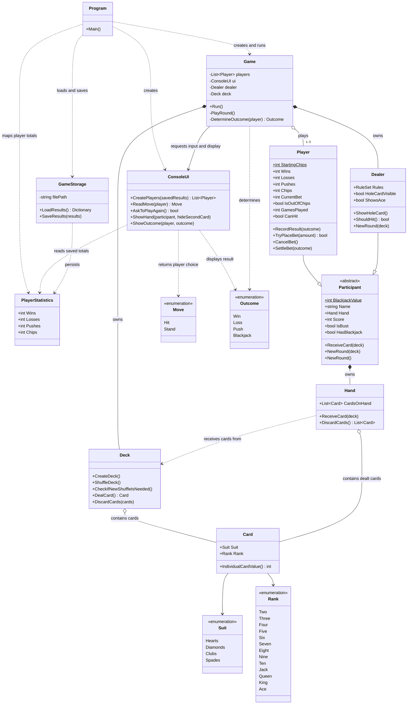

# Blackjack Class Diagram and Responsibilities

This document describes the current runtime structure of the console Blackjack game. It focuses
on which class owns each responsibility and how the main objects collaborate.

## Class diagram

## Responsibility boundaries

| Class | Responsibility | Should not own |
|---|---|---|
| `Program` | Composition root: load saved totals, create the UI and game, start play, and save totals on exit. | Round rules or card scoring. |
| `ConsoleUI` | Read and validate console input; display players, hands, prompts, and outcomes. | Game flow, scoring, or file access. |
| `Game` | Coordinate rounds, player turns, dealer turn, result calculation, and statistics updates. | JSON serialization or low-level console input parsing. |
| `GameStorage` | Load, save, and delete cumulative player statistics from JSON and keep the readable `player-results.txt` summary in sync. | Running a round or interacting with the console. |
| `PlayerStatistics` | Represent the persisted wins, losses, and pushes for one player. | Game behavior or persistence operations. |
| `Participant` | Share a name, hand, card receiving, score calculation, bust/blackjack checks, and round reset. | Player-specific statistics or dealer policy. |
| `Player` | Track one player's wins, losses, and pushes. | Console interaction or saved-file management. |
| `Dealer` | Represent the dealer, reveal the hole card, and apply the hit/stand threshold. | Choosing moves interactively. |
| `Deck` | Create and shuffle the deck, deal cards, and recycle discards when needed. | Hand scoring or round outcomes. |
| `Hand` | Hold cards and receive or clear them. | Deciding the winner. |
| `Card` | Store a suit and rank and provide the card's base value. | Adjusting ace values for a complete hand. |
| `Move` | Define the player's available choices: hit or stand. | Input or game flow. |
| `Outcome` | Define the possible round results: win, loss, or push. | Calculating results. |

## Runtime flow

1. `Program` loads the saved statistics with `GameStorage`.
2. `ConsoleUI` asks for one to five player names and creates each `Player`, initialized with any
   saved totals.
3. `Program` creates `Game` and starts its `Run` method.
4. `Game` deals and coordinates player turns, reveals the dealer's hole card, plays the dealer's
   turn, and settles each player's result.
5. `ConsoleUI` handles the prompts and output requested by `Game`.
6. When the players quit, `Program` merges the current players' totals into the loaded statistics
   and saves them with `GameStorage`.

## Notes

- `Round.cs` currently exists as an unused placeholder; `Game` owns the round flow directly.
