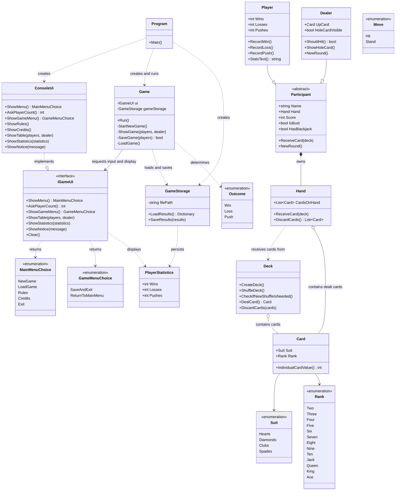

# Blackjack Class Diagram and Responsibilities

This document describes the current runtime structure of the console Blackjack game. It focuses
on which class owns each responsibility and how the main objects collaborate.

## Class diagram

## Responsibility boundaries

| Class | Responsibility | Should not own |
|---|---|---|
| `Program` | Composition root: create the console UI and storage, inject them into the game, and start the application. | Menu flow, card rendering, or JSON serialization. |
| `IGameUI` | Define the UI operations that game flow can request without depending on a console implementation. | Rendering or game rules. |
| `ConsoleUi` | Implement `IGameUI` with Spectre.Console menus, tables, prompts, and messages. | Game flow, statistics persistence, or outcome rules. |
| `Game` | Coordinate application/game flow and request input or display through `IGameUI`. | Depending on `ConsoleUi` or rendering console output directly. |
| `GameStorage` | Load and save player statistics to the JSON file. | Menu flow or console interaction. |
| `PlayerStatistics` | Represent the persisted wins, losses, and pushes for one player. | Game behavior or persistence operations. |
| `Participant` | Share a name, hand, card receiving, score calculation, bust/blackjack checks, and round reset. | Player-specific statistics or dealer policy. |
| `Player` | Track one player's wins, losses, and pushes. | Console interaction or saved-file management. |
| `Dealer` | Represent the dealer, reveal the hole card, and apply the hit/stand threshold. | Choosing moves interactively. |
| `Deck` | Create and shuffle the deck, deal cards, and recycle discards when needed. | Hand scoring or round outcomes. |
| `Hand` | Hold cards and receive or clear them. | Deciding the winner. |
| `Card` | Store a suit and rank and provide the card's base value. | Adjusting ace values for a complete hand. |
| `Move` | Define the player's available choices: hit or stand. | Input or game flow. |
| `Outcome` | Define the possible round results: win, loss, or push. | Calculating results. |

## Runtime flow

1. `Program` creates `ConsoleUi`, `GameStorage`, and `Game`, passing the UI and storage into the
   game.
2. `Game` requests menu input and display operations through `IGameUI`.
3. `ConsoleUi` implements those requests with the console and Spectre.Console.
4. `Game` uses `GameStorage` to load and save player statistics.

## Notes

- `Round.cs` currently exists as an unused placeholder; `Game` owns the round flow directly.
- Console text is currently in English. The project also contains Swedish user stories and
  terminology; localizing the prompts is a separate UI responsibility.
